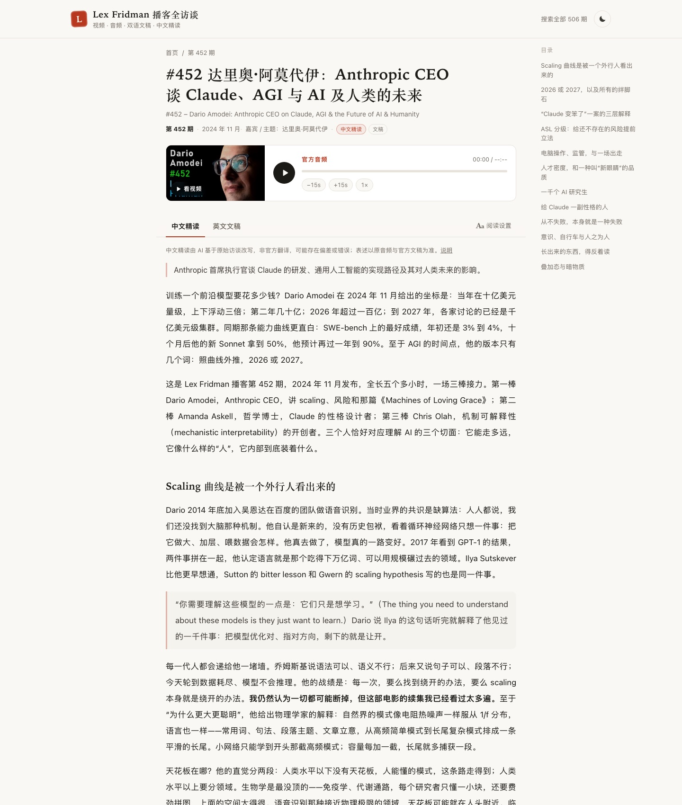

# lexfridman-cn · Lex Fridman 播客中文站

**中文** | [English](#english)


> 把 [Lex Fridman Podcast](https://lexfridman.com/) 全部 506 期变成**可以读、可以搜、可以追**的中文站：AI 中文精读持续批产、官方音频/视频直链、中英双语标题、全文搜索——一期一个独立 URL，纯静态，一条命令全量构建。
>
> A Chinese companion to the Lex Fridman Podcast: all 506 episodes with AI deep-reads, official audio & video, bilingual titles, and full-text search — one URL per episode, built by a single Python script.

[**在线阅读 →**](https://lex.qiaomu.ai/) · [RSS 全文订阅](https://lex.qiaomu.ai/feed.xml) · [免责声明](https://lex.qiaomu.ai/disclaimer/)
[](LICENSE)
[](https://lex.qiaomu.ai/)

**已验证（2026-10-19）**：`python3 tools/build.py` → 506 个单集页 / sitemap 508 条 / RSS 最新 20 期全文；本仓库截图即本地构建产物。

## 这是什么

[Lex Fridman Podcast](https://lexfridman.com/) 每期三五个小时，英文听力门槛 + 找期困难，让大部分精彩访谈被埋没。这个项目做了三件事：

1. **每期一页**：官方音频播放器（倍速记忆、断点续听）、视频封面点击加载、中英双语标题与嘉宾简介、英文文稿时间戳跳播；
2. **中文精读**：AI 基于完整访谈改写的长文导读（463+ 篇，批产管线持续补齐），不是机器翻译，是「替你先听一遍」的深度转述；
3. **找得到**：全文搜索（`/` 或 `⌘K` 唤起，多词 AND、嘉宾>标题>简介加权、URL 同步可分享）、明暗主题、阅读进度记忆与「继续收听」。

非官方粉丝项目。本站不托管任何音频/视频/文稿文件，全部直链官方源，详见[免责声明](https://lex.qiaomu.ai/disclaimer/)。

## 核心能力

| 能力 | 你得到什么 |
|---|---|
| 中文精读全文 | 463+ 篇 AI 深度改写导读，批产管线持续更新，RSS 全文可订阅 |
| 官方音频 + 视频 | 直链官方源播放：倍速记忆、±15s、断点续听、迷你播放条、视频缩略图点击加载 |
| 全文搜索 | 全半角/标点归一化、多词 AND、加权排序、期号精确命中、关键词高亮、`/` / `⌘K` 唤起 |
| 阅读体验 | 精读目录侧栏（滚动高亮）、阅读设置（黑体/宋体 + 15–21px 字号）、明暗主题、阅读进度记忆 |
| 英文文稿 | 三梯队供给：官方文稿 > 本地 Whisper ASR > 存档；时间戳点击跳播、文稿内 `Enter`/`↑↓` 逐处跳转 |
| 订阅与 SEO | RSS 最新 20 期精读全文（真实 enclosure 长度、ETag/304）、JSON-LD（含 SearchAction）、sitemap、llms.txt |

## 详情页一览



## 快速开始

### 最快路径：构建 + 本地预览

构建只用 Python 标准库，零第三方依赖：

```bash
git clone https://github.com/joeseesun/lexfridman-cn.git
cd lexfridman-cn

python3 tools/build.py                 # 全量构建到 site/
python3 -m http.server 8123 -d site    # 打开 http://127.0.0.1:8123
```

成功标志：首页出现「506 期访谈 / 463+ 篇中文精读」统计与单集卡片，搜索、筛选、详情页、RSS（`/feed.xml`）全部可用。元数据（`tools/lex-master.json`、`translations.json`）与精读全文（`site/zh/`）已入库，clone 下来即是全量数据。

<details>
<summary><strong>完整管线：自动追新 + 精读批产（macOS）</strong></summary>

精读生成与自动追新依赖 [Magpie](https://magpie.qiaomu.ai/v1) LLM 网关（或任意 OpenAI 兼容端点，改 `tools/gen_zh.py` 顶部的 `BASE_URL`）与 macOS 钥匙串：

```bash
# 1) 把网关 key 放进钥匙串（工具链统一从这里读，不落盘、不进环境变量）
security add-generic-password -s qiaomu-llm -a magpie -w <你的KEY>

# 2) 与官方 RSS 对账：新期 → 补元数据/YouTube ID → 翻译标题 → 补文稿 → 构建部署
python3 tools/sync_new.py --dry-run    # 先看它打算做什么
python3 tools/sync_new.py

# 3) 精读批产：常驻运行，每 10 分钟扫描新文稿，每 30 篇自动部署
python3 tools/gen_zh.py --watch

# 4) 官方还没放出文稿的新期：下载官方 MP3 本地转写（Apple Silicon）
pip install mlx-whisper
```

定时化：`crontab` 每日跑一次 `sync_new.py` 即可全自动追新；部署目标是脚本里的 `rsync` 目标，改成你自己的主机路径即可。solo 特别节目等 RSS 非标准条目需在 `lex-master.json` 手工补一条。

</details>

## 工作原理

```
官方 RSS (lexfridman.com/feed/)
        │  tools/sync_new.py        每日对账:新期 → master/feed_audio → 标题翻译
        │                            文稿三梯队:官方 > ASR(本地 whisper) > 存档
        ▼
tools/lex-master.json     506 期元数据(期号/标题/日期/slug/YouTube ID)
tools/translations.json   AI 中文标题 / 嘉宾 / 一句话简介
tools/official/*.txt      官方文稿(fetch_official.py 抓取)
site/transcripts/*.txt    存档/ASR 文稿(不入库)
        │  tools/gen_zh.py --watch   中文精读批产(禁句式校验、带反馈重试)
        ▼
site/zh/*.html            中文精读全文（入库，随批产更新）
        │  tools/build.py           全量构建:506 个单集页 + sitemap + llms.txt + RSS
        ▼
site/  ──rsync──►  任意静态主机
```

- **sync_new.py** — 每日与官方 RSS 对账：补元数据、翻译标题、按三梯队补文稿、保证精读管线存活，最后构建 + rsync。
- **gen_zh.py --watch** — 精读批产：系统提示词驱动的长文改写，内置禁句式校验（机器翻译腔），不合格带反馈重试，多模型路由按质量动态排序。
- **build.py** — 全量静态构建：单集页（播放器/视频/tabs/JSON-LD/上下期）、首页数据、sitemap、llms.txt、RSS 全文订阅。

## 项目结构

```
├── tools/
│   ├── build.py             # 全量静态构建（纯标准库）
│   ├── sync_new.py          # 每日追新：RSS 对账 → 文稿 → 构建 → rsync
│   ├── gen_zh.py            # 精读批产（--watch 常驻）
│   ├── translate_titles.py  # 标题/嘉宾/简介 中文翻译
│   ├── fetch_official.py    # 官方文稿抓取
│   ├── lex-master.json      # 506 期元数据（入库）
│   ├── translations.json    # 双语标题/嘉宾/简介（入库）
│   └── official/            # 官方文稿（不入库）
├── site/
│   ├── zh/                  # 463+ 篇中文精读全文（入库）
│   ├── transcripts/         # 存档/ASR 文稿（不入库）
│   ├── data/zh-index.json   # 精读索引（入库）
│   └── app.js / ep.js / style.css / index.html
├── docs/screenshots/        # README 截图（本地构建实拍）
└── LICENSE                  # MIT（仅代码）
```

## 内容与版权边界

- 代码以 [MIT](LICENSE) 授权——**仅限代码**；`site/zh/` 中文精读与元数据不适用 MIT。
- 中文精读是本项目 AI 辅助生成的二次创作，已在站点与 RSS 全文公开；如需转载请**署名并链接对应原文页面**。
- 英文文稿（官方 / 存档 / ASR）版权归 Lex Fridman、嘉宾及制作方所有，本仓库**不包含、不分发**，管线在本地自行获取或转写。
- 精读为 AI 生成、非官方翻译，可能存在偏差，表述以原始访谈为准；完整说明见[免责声明](https://lex.qiaomu.ai/disclaimer/)。

## 已知限制

- 精读批产与自动追新依赖 macOS（钥匙串、`mlx-whisper`）；**仅构建站点**则任意平台的 Python 3 即可。
- 精读管线默认走乔木的 Magpie 私有网关，外部使用需换成自己的 OpenAI 兼容端点（改 `BASE_URL` 一行）。
- 官方文稿抓取依赖 lexfridman.com 的页面结构，站点改版时 `fetch_official.py` 需要跟进。
- 中文精读仍在批产补齐中（463+/506），新文稿由管线按天追加。

## 贡献

欢迎两类贡献：

- **精读纠错**：发现错别字、人名/数字错误或明显误读，开 Issue 并注明期号即可；
- **代码 PR**：构建、搜索、播放器、管线的问题修复与改进。

不接受与托管媒体文件相关的改动——这是项目的版权边界，见上文。

## 关于向阳乔木

- 博客：[blog.qiaomu.ai](https://blog.qiaomu.ai) · 主页：[qiaomu.ai](https://qiaomu.ai) · [tuijian.qiaomu.ai](https://tuijian.qiaomu.ai)
- X：[@vista8](https://x.com/vista8) · GitHub：[@joeseesun](https://github.com/joeseesun)
- 微信公众号：**向阳乔木推荐看**

---

<a name="english"></a>
# English

**[中文](#lexfridman-cn--lex-fridman-播客中文站)** | English

A Chinese companion to the [Lex Fridman Podcast](https://lexfridman.com/) — all 506 episodes on one static site, [lex.qiaomu.ai](https://lex.qiaomu.ai/), with AI-written Chinese deep-reads, official audio/video, bilingual titles, transcripts, and full-text search. One URL per episode, generated by a single stdlib-only Python script.

## What you get

- **Chinese deep-reads (463+ and growing)** — AI-rewritten long-form guides based on the full interviews, not machine translation; published on the site and in a full-text RSS feed.
- **Official audio & video** — deep links only (nothing hosted here): speed memory, resume playback, mini player, click-to-load video.
- **Full-text search** — normalization, multi-word AND, weighted ranking (guest > title > description), exact episode numbers, keyword highlighting, `/` or `⌘K`, shareable `?q=` URLs.
- **Reading experience** — table-of-contents sidebar with scroll highlighting, font/size reading settings, dark mode, progress memory and "continue listening".
- **English transcripts** — three-tier sourcing (official > local Whisper ASR > archive), timestamp-deep-linked to the player.
- **SEO & subscriptions** — RSS (latest 20 episodes, full text, real enclosure lengths, ETag/304), JSON-LD, sitemap, `llms.txt`.

## Quick start

```bash
git clone https://github.com/joeseesun/lexfridman-cn.git
cd lexfridman-cn
python3 tools/build.py                 # builds everything into site/
python3 -m http.server 8123 -d site    # open http://127.0.0.1:8123
```

Metadata (`tools/lex-master.json`, `translations.json`) and the deep-read corpus (`site/zh/`) are committed, so the clone builds a complete site with zero third-party dependencies.

The content pipeline (auto-syncing new episodes + generating deep-reads) is macOS-oriented: it reads the LLM key from the Keychain, defaults to the author's private [Magpie](https://magpie.qiaomu.ai/v1) gateway (swap `BASE_URL` in `tools/gen_zh.py` for any OpenAI-compatible endpoint), and uses `mlx-whisper` for local ASR. See the Chinese section above for details.

## Content & license boundaries

- Code is [MIT](LICENSE)-licensed — **code only**. The Chinese deep-reads in `site/zh/` and metadata are not MIT: if you republish them, attribute and link back to the original episode page.
- English transcripts (official / archive / ASR) belong to Lex Fridman, guests, and producers; they are **not included or distributed** in this repo — the pipeline fetches or transcribes them locally.
- Deep-reads are AI-generated, unofficial, and may contain errors; the original interviews are authoritative. See the [disclaimer](https://lex.qiaomu.ai/disclaimer/) (in Chinese).

## Author

向阳乔木 (Qiaomu) — [blog.qiaomu.ai](https://blog.qiaomu.ai) · X [@vista8](https://x.com/vista8) · GitHub [@joeseesun](https://github.com/joeseesun)
